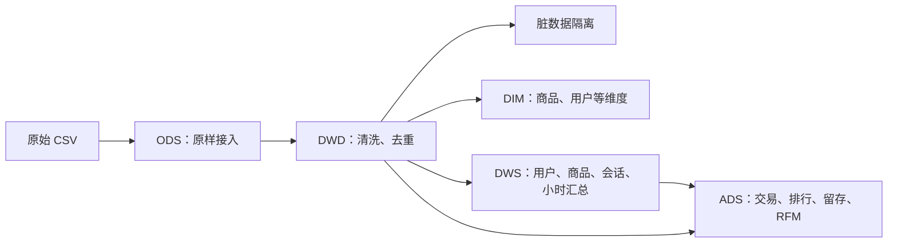
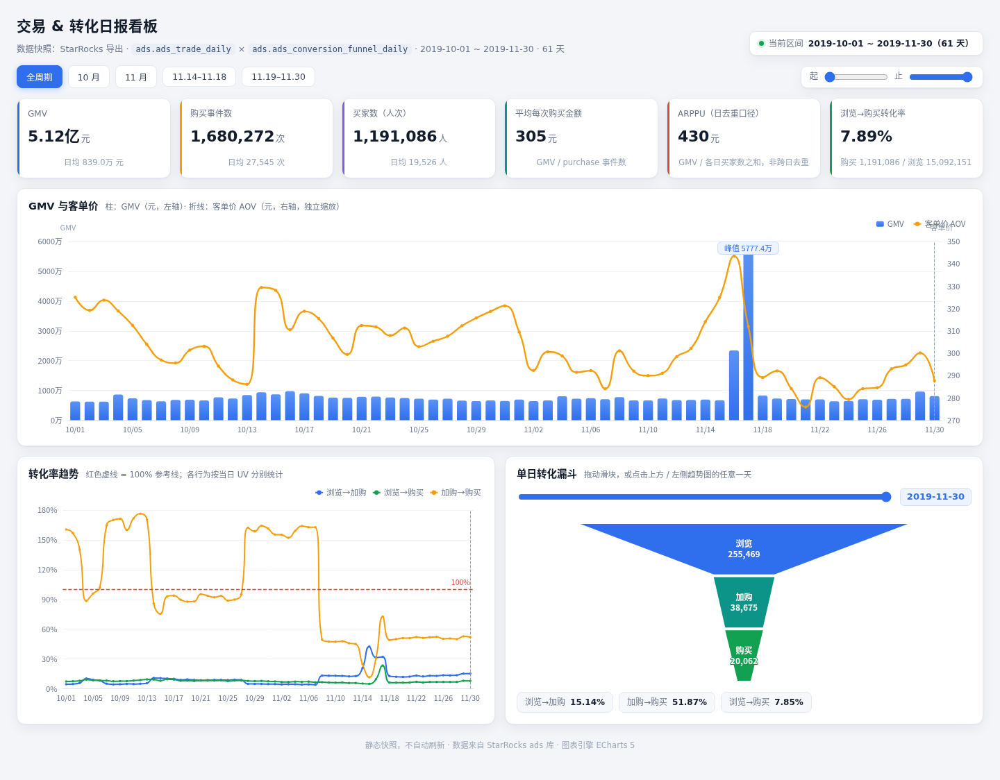
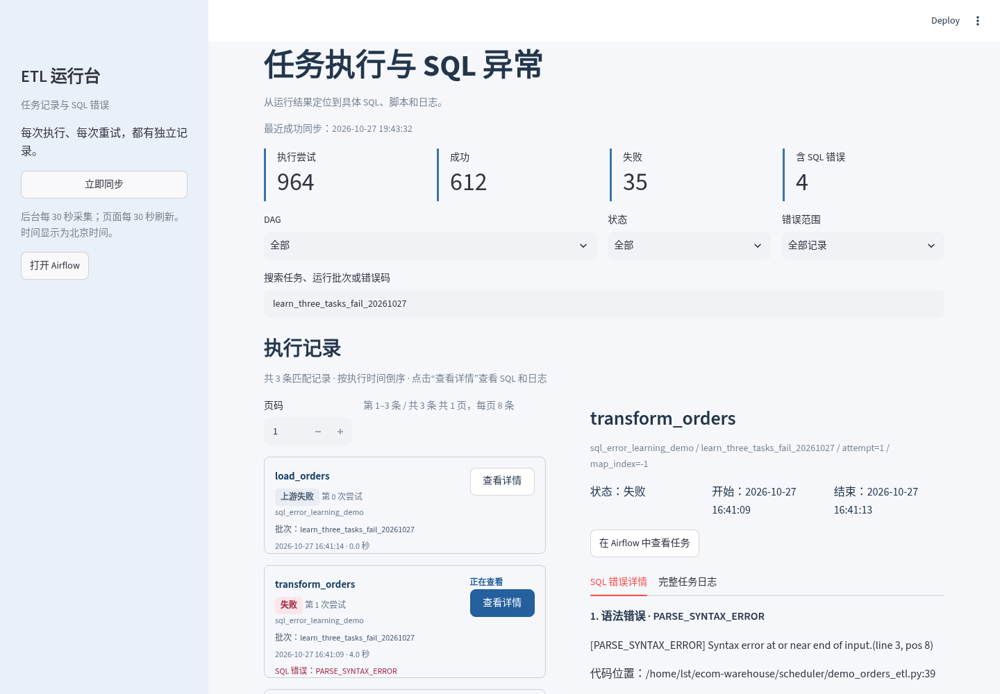

# 电商离线数仓（Spark + Hive + Airflow）

这个项目把电商的浏览、加购、购买日志，整理成可以直接查询的交易、用户、商品和留存指标。
数据来自 [Kaggle eCommerce behavior](https://www.kaggle.com/datasets/mkechinov/ecommerce-behavior-data-from-multi-category-store)，覆盖 2019 年 10–11 月。

主链路由 Spark 计算、Hive 外部表管理、Airflow 调度。另有一个运行台，用来集中查看每次任务的状态、重试和 SQL 报错。
已有全量运行记录包含 **61 个日分区、109,806,507 条 DWD 事实数据**；这是单机项目，不是生产集群。

阅读顺序：[数据流转](#数据怎么流转) → [运行方法](#怎么运行) → [结果](#已经跑出的结果) → [业务看板](#交易与转化看板) → [错误定位](#任务失败后怎么看)。

## 数据怎么流转



| 层 | 表数 | 具体做什么 |
|---|---:|---|
| ODS | 1 | 保留原始事件，按 UTC 日期分区 |
| DWD | 2 | 过滤非法记录、稳定去重、派生购买标记；脏数据单独保存 |
| DIM | 5 | 维护商品历史版本，以及用户、会话、品类、日期维度 |
| DWS | 4 | 按天汇总用户行为、商品表现、会话和小时流量 |
| ADS | 7 | 计算交易日报、漏斗、商品榜、会话、分时、留存和 RFM |

共 19 张表，定义集中在 [etl/ddl.py](etl/ddl.py)。DWS 直接使用事实表中的事件属性，减少不必要的维度关联；需要精确用户去重的指标会回到 DWD 计算。

## 怎么运行

### 先看一个小样例

需要 Python 3.10 和 JDK 17。样例不需要下载完整数据，也不需要启动 HDFS、MySQL 或 Airflow。

```bash
python3.10 -m venv .venv
.venv/bin/python -m pip install -r requirements.txt
bash examples/warehouse/run.sh
# 可选：完整重跑，比较 19 张表的结果是否一致
bash examples/warehouse/run.sh --verify-rerun
```

它用 8 天、37 条合成事件，调用正式的建表和 ETL 代码。输出放在独立临时目录，不读取或覆盖已有数仓。
输入包含重复事件、非法事件、空主键、负价格和商品属性变化，具体见 [样例说明](examples/README.md)。

### 再跑正式数据

正式环境使用 Spark standalone、HDFS 和 Hive catalog。已有环境版本是 Python 3.10、JDK 17、Spark 3.5.9、PySpark 3.5.8、Hadoop 3.4.3；样例使用 pip 自带的 Spark 3.5.8。

```bash
# 1. 配置自己的路径和连接信息
cp .env.example .env
# 编辑 .env：DW_FS_URI、DW_WAREHOUSE_URI、DW_SOURCE_CSV
# 并先启动 HDFS / Spark，配置好 Hive catalog

# 2. 上传源文件，创建 19 张表
hdfs dfs -mkdir -p /data/ecommerce
hdfs dfs -put 2019-Oct.csv /data/ecommerce/
./run.sh ddl

# 3. 导入 ODS，计算 10 月数据，最后做跨层对账
./run.sh ods-bulk --csv hdfs://localhost:8020/data/ecommerce/2019-Oct.csv
./run.sh build --start 2019-10-01 --end 2019-10-31

# 4. 只检查结果，不重新计算
./run.sh check --start 2019-10-01 --end 2019-10-31
```

配置优先级是“进程环境变量 > .env > 默认值”。不需要为了换路径修改 Python。
具体环境配置与报错处理见 [从零跑通](docs/GETTING_STARTED.md)，各组件安装方式见 [依赖说明](requirements/README.md)。

日常增量和单表执行仍走原来的 run.sh：

```bash
./run.sh day 2019-11-01          # 导入当天 ODS 并校验
./run.sh build --dt 2019-11-01   # 计算当天各层；留存/RFM 使用截至当天的数据
./run.sh dwd --dt 2019-11-01     # 单独重跑一张表
./run.sh dim-scd2 --dt 2019-11-01
```

## 已经跑出的结果

### 61 天完整数据的已有运行记录

下面是原项目保留的全量结果；本次文档整理没有重新跑全量。早期 10 月结果单独放在后面的折叠区，避免混用数据范围。

| 项目 | 结果 |
|---|---:|
| DWD 事实数据 | 109,806,507 条，61 个日分区 |
| 购买事件 | 1,680,272 次 |
| GMV | 511,810,289.17 |
| 商品历史版本 | 222,761 个版本，206,876 个商品 |
| 用户维度 | 5,316,649 人 |
| RFM 当前快照 | 707,466 个购买用户，快照日 2019-11-30 |

购买次数、GMV、分时 PV 和留存分别做跨层核对，已有输出如下：

```text
OK 购买次数守恒 DWD=DWS用户=DWS商品=DWS会话=ADS: 1,680,272
OK GMV 守恒     DWD=DWS用户=DWS商品=ADS: 511,810,289.17
OK SCD2 每商品单一当前版本: 0 个违规
OK 分时守恒 DWS=ADS=DWD明细: PV 109,806,507 / 购买 1,680,272
OK 留存覆盖与不变量: 61/61 天，0 天违规；其中 7 天右删失（NULL）
```

### 小样例能直接验证的结果

| 检查 | 预期结果 |
|---|---|
| 清洗和去重 | 37 条输入 = 32 条事实 + 3 条脏数据 + 2 条去重记录 |
| 购买与金额 | 12 次购买、GMV 120，各汇总层一致 |
| 商品版本 | alpha → beta，保存两个版本，只有一个当前版本 |
| 留存 | 超出观察窗口的 D+7 为 NULL，不按 0 处理 |
| RFM | 两个购买用户，只保留当前快照 |
| 完整重跑 | 19 张表的结果摘要一致 |

小样例是为了让读者复现计算逻辑，不用来证明亿级数据的性能。实际输出保存在 [result.json](examples/warehouse/result.json)。

<details>
<summary>查看早期 10 月结果与业务观察</summary>

### 10 月早期运行结果

其中 ODS 的计数还包含 11-01～11-03 分区，不能与下列 10 月 DWD 行数直接相减；其余指标按各自统计窗口阅读。

| 层 | 表数 | 代表表规模 |
|---|---|---|
| ODS | 1 | `ods_event_log` 47,017,436 行 |
| DWD | 2 | `dwd_event_fact` 42,413,557 行 |
| DIM | 5 | `dim_product_scd2` 172,794 版本 / `dim_user` 3,022,290 |
| DWS | 4 | `dws_user_session_daily` 9,280,709 行 |
| ADS | 7 | `ads_user_rfm_snapshot` 347,118 用户 |

对账结果（全部通过）：

```
OK 购买次数守恒 DWD=DWS用户=DWS商品=DWS会话=ADS: 742,773
OK GMV 守恒     DWD=DWS用户=DWS商品=ADS: 229,933,212.63
OK 漏斗不变量（每日 view_uv 为上游最大值）: 0 天违规
OK SCD2 每商品单一当前版本: 0 个违规
OK 分时守恒 DWS=ADS=DWD明细: PV 42,413,557 / 购买 742,773
OK 留存不变量（D+n 人数 ≤ D0）: 0 天违规
```

2019-10 业务洞察：

- RFM 人群贡献存在差异：「重要价值客户」占购买用户的 12.2%，贡献 55.6% 的 GMV
- 留存（基准日 10-16，D0 = 230,199）：D+1 17.68% / D+3 13.20% / D+7 10.74%，单调递减；月末右删失记 NULL 而非 0
- 分时流量峰谷比 13.76×：上午(7-12) 转化最高（贡献 41.04% 订单），晚间(19-23) 客单价最高（354 元）


</details>

<details>
<summary>查看 61 天源数据中的缺失、分布突变和漏斗现象</summary>

### 源数据质量观察（61 天）

将窗口扩展到 61 天检查源数据，发现三类现象。这些是数据中观察到的现象，分析时需要区分源数据特征、采集问题与业务变化，不能只按汇总指标推断原因。

### 1. purchase 事件存在连续缺失小时

11-14 ~ 11-17 四天里 `view` / `cart` 都覆盖满 24 小时，`purchase` 只覆盖 19 / 0 / 8 / 21 小时（11-15 原始 purchase 全天 0 条）。这提示 purchase 事件可能存在采集缺失，但仅凭该数据不能确认上游原因。

> 判别方法：按日期 × 事件类型 × 小时统计覆盖小时数。缺小时的情况不会像总量那样被高流量日掩盖。

### 2. 11-14 ~ 11-17 的 UV 与行为分布突变

11-14 ~ 11-17 出现了明显的数据分布变化，有以下观测：

| 证据 | 观测 |
|---|---|
| 切换边界 | 变化集中在自然日边界，前后相邻日分布不同 |
| 放大倍数 | view 3.13× / cart 5.96× / purchase 8.10×，不同事件的变化倍数不一致 |
| 分布形状 | 每用户事件数整条分布平移、形状不变（p50 3→6、p90 16→32、p99 52→106），不是尾部抬高 |
| 用户池 | 与前后日的重叠率接近随机期望，需结合上游信息进一步解释 |

> 这些观测提示采集口径或业务流量可能变化；仅凭公开数据不能确认上游原因，不据此断言采集系统发生了切换。

### 3. 语义 / 一致性：源数据自带，不是算错

- 漏斗倒挂在源数据中已经存在：61 天里有 22 天 `purchase_uv > cart_uv`（转化率最大 1.763；会话级 21 天 > 1，最大 1.324）。一部分与上面的 purchase 缺失、cart 分布变化相关，另一部分是加购与下单可跨天的窗口语义，属于源数据特征。
- 存在 `price = 0` 的购买事件：有销量而零金额的情况在源数据内部自洽，不是丢单。
- 存在当日无浏览的购买：购买 UV 可以超过曝光 UV（曝光只统计 `view`），因为用户当天不浏览也能下单。这是 61 天观察窗口截断和跨天行为的结果。


</details>

## 交易与转化看板

将 ADS 交易日报和漏斗日报导出后，可以直接查看 GMV、平均购买金额、转化率趋势和单日漏斗。
支持切换 10 月/11 月、自定义日期范围，以及点击趋势图联动单日漏斗。



**[下载看板 HTML](https://github.com/wushi007/offline-data-warehouse/raw/refs/heads/main/dashboards/trade_funnel_dashboard.html)**，保存后用浏览器打开。图表和数据都在文件中，离线可用，不需要连接 StarRocks；GitHub 文件页只显示源码。

看板使用 2019-10-01～11-30 的 61 天导出快照，金额与购买次数和上面的全量记录一致，不会实时刷新。
其中“购买事件数”不是业务系统的独立订单数；每天的 UV 各自去重，区间累加为人次，漏斗比例也不等于同一批用户的完整转化路径。
具体口径见 [看板说明](dashboards/README.md)。

## 任务失败后怎么看

通过 Airflow 运行时，进入 DAG → 运行批次 → 失败的层任务 → Logs。
手动执行 run.sh 时，日志输出到当前终端，不会自动出现在 Airflow。

运行台把这些信息集中到一个页面：选中任务后，可以看到错误码、SQL、出错行列、脚本位置和完整日志。下面是故意漏写 GROUP BY 字段的样例任务截图：



样例的状态应当是：

| 提取 extract_orders | 转换 transform_orders | 加载 load_orders |
|---|---|---|
| 成功 | 失败：PARSE_SYNTAX_ERROR | 上游失败，未执行 |

在 Airflow 中重新触发，配置 `{"fix_sql": true}`，三个任务应全部成功。三个任务用 XCom 传递 Parquet 路径，不跨进程传 DataFrame；代码与安装方式见 [样例说明](examples/README.md)。

运行台启动命令：

```bash
.venv/bin/python -m pip install -r requirements/monitoring.txt
export ETL_AIRFLOW_ENV=/你的/airflow-env.sh
export ETL_AIRFLOW_PYTHON=/你的/airflow-venv/bin/python
bash monitoring/start.sh
# 打开 http://localhost:8502；停止时运行 bash monitoring/stop.sh
```

每次重试单独记录。当前支持本机 Airflow 3.3 的元数据和日志，SQL 分类是规则提取；未匹配到 SQL 错误时仍需查看完整日志。详见 [运行台说明](monitoring/README.md)。

## 几个实现上的取舍

| 做法 | 为什么这样做 |
|---|---|
| 稳定排序后去重 | 避免同一输入重跑时随机保留不同商品属性 |
| 事实和脏数据共用规则 | 解释数据去哪了，核对输入、保留、隔离和去重的数量 |
| 日表覆盖目标分区 | 修正某一天时不需要重算全部日期 |
| 商品历史按天记录 | 源数据没有商品主数据，只能从每日主导属性估计变化 |
| 留存窗口不足记 NULL | “还没观察到”与“观察到但没有留存”含义不同 |
| Airflow 按层调度，层内共用 Session | 减少启动开销和多个 JVM 同时占用内存；代价是按层重试 |

现有机器是 16 GB 内存笔记本，WSL2 实际可见约 7.6 GB。正式配置使用 driver 1g、4×1g executor，并用 flock 限制手动和调度任务同时运行。这是本机的资源安排，不是通用的最优参数。

Spark 参数模板见 [conf/spark-env.sh.example](conf/spark-env.sh.example)。切换本地模式可以设置 `SPARK_MASTER=local[6]`；正式任务与本地样例的配置相互独立。

## 代码和文档在哪里

| 位置 | 内容 |
|---|---|
| [etl/](etl/) | 五层 ETL；ddl.py 建表，pipeline.py 编排和对账 |
| [scheduler/](scheduler/) | 正式 Airflow DAG、质量阻断和告警 |
| [monitoring/](monitoring/) | 任务记录、SQL 异常提取和查看页 |
| [dashboards/](dashboards/) | 可离线打开的交易与转化看板 |
| [examples/](examples/) | 可运行的五层小样例和 SQL 故障样例 |
| [requirements/](requirements/) | 核心与可选组件的安装清单 |
| [docs/GETTING_STARTED.md](docs/GETTING_STARTED.md) | 环境准备、正式数据运行、常见报错 |
| [docs/CODE_GUIDE.md](docs/CODE_GUIDE.md) | 各层代码和计算口径 |
| [docs/incremental/ALERTS.md](docs/incremental/ALERTS.md) | 告警配置和已知限制 |

StarRocks 查询对照与倾斜实验是可选内容，不影响主链路。分别见 [查询基准](docs/legacy/PERFORMANCE_BENCHMARK.md) 和 [热点聚合实验](skew_lab/README.md)；结果受数据、资源、缓存和测量方法影响。

## 已知限制

- 单机批处理；覆盖写不具备数据库事务回滚，不承诺高可用。
- 商品版本是从行为数据推断，时间精度到天；缺少观测的区间不一定连续。
- 购买次数是 purchase 事件次数，源数据没有真实订单主键；GMV 也不包含退款等未提供的信息。
- RFM 只保留当前快照，不是按日保存的历史快照仓库。
- 数据中存在漏斗倒挂、零金额购买等现象，需要结合统计窗口理解，不能把每种偏差都当成计算错误。

## 许可

[MIT](LICENSE)
